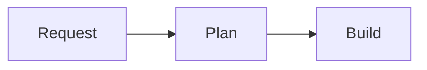

# Planning Markdown rendering

Planning detail renders descriptions, current/revision specs, questions, and both
assistant and user discussion text with Goldmark (CommonMark plus tables and
strikethrough). `markdown.go` is the shared trusted-HTML boundary: raw HTML remains
disabled in Goldmark and a narrow Bluemonday allowlist sanitizes generated HTML
before `templ.Raw`. Scripts, event handlers, styles, embedded HTML and images
(including remote tracking images) are not permitted. Links allow HTTP, HTTPS,
mailto and relative destinations, with nofollow/noreferrer; no new-tab target is
added. Code is escaped and displayed without executing or interpreting HTML.

`planningDiscussionMessage` renders persisted readable Markdown directly. Typed
`proposeSpec` acceptance stores a structured immutable revision (spec and commit; no questions) and a readable history message in the same transaction.
The Discussion section displays typed `clarify` questions, accepted typed planning blockers and subsequent
user replies, including plan-review feedback. The initial user description,
proposals and arbitrary assistant output are excluded; original
messages remain persisted unchanged. Accepted typed reports identify question
messages, including in existing sessions, without parsing discussion prose as
reports. Clarify stores questions as a typed interaction without creating a
revision. Discussion Markdown is never decoded as JSON or repaired. Current
and historical revision surfaces use their persisted structured fields.

Typography is scoped to `.planning-markdown` in `frontend/src/style.css`, using
the existing night palette. Lists, headings, links, inline/fenced code,
blockquotes and tables have explicit styles after Tailwind preflight. Tables and
code blocks scroll within the content width on narrow screens.

## Regeneration and checks

From the repository root:

```sh
go run github.com/a-h/templ/cmd/templ@v0.3.1070 generate -f internal/orchestrator/planning.templ
(cd internal/orchestrator/frontend && npm run build)
go test ./...
go vet ./...
golangci-lint run ./...
```

The pinned generator matches go.mod. Only planning's generated template is
included; unrelated generator-version churn is excluded. Renderer tests cover
Markdown elements, escaped code, safe links, dangerous schemes, raw HTML and
tracking images. Template tests cover planning surfaces, structured persisted
revisions, readable discussions, literal natural/user messages and approval controls.

Build/Fix discussion uses the same sanitizer for typed blocker reasons and durable
operator replies; report identity, not Markdown content, distinguishes exchanges.

## Mermaid diagrams

Use an exactly lowercase `mermaid` fence (backticks or tildes):

````markdown

````

Mermaid 12.2.0 is pinned and bundled into the embedded application asset, with
its MIT notice. No Node runtime, CDN or third-party network access is needed.
Full-card descriptions, current/revision plans, questions and both directions of
Planning and Build/Fix discussion support diagrams, as does assignment plan
review. Runs Chat/Trace and board thumbnails do not hydrate diagrams.

Goldmark still rejects raw HTML; Bluemonday permits only the exact generated
`language-mermaid` code class, not SVG or arbitrary HTML attributes. The client
uses Mermaid's strict SVG sanitizer, disables HTML labels and automatic scanning,
locks security/limit configuration and never binds diagram callbacks. Configuration
frontmatter/directives, HTML, encoded markup, click/image/icon constructs, URLs
and custom styles are deliberately unsupported and fall back to source before
rendering, preventing resource fetches during layout as well as in final output.

Successful diagrams have an accessible label and keyboard-operable **Diagram
source** disclosure. Invalid, unsafe or oversized diagrams retain escaped code
and a local status; disabled/failed JavaScript leaves the original code visible.
Source and edge limits are 50,000 characters and 500 edges per diagram. Rendering
is serialized, disconnected/changed results are discarded, and a page-local cache
holds at most 64 successes/failures. Snapshot patches restore cached diagrams with
fresh SVG IDs without freezing Markdown or forms. Unchanged retained source
fences restore their own Diagram source disclosure state after morphs, independently
even for identical diagrams. Changed/new fences default closed. Disclosure state
is page-local, not persisted in browser storage or across navigation/reload.
Hidden revisions render using a staging area so they remain usable when opened.
These limits are not a hard
CPU timeout for in-process browser JavaScript; complex accepted input can still
occupy the browser while Mermaid renders.

Browser regression test (exports production Go markup and exercises real finite
Datastar SSE frames; requires Chromium):

```sh
(cd internal/orchestrator/frontend && npm ci && npm run build && npm run test:mermaid)
# Optional: CHROMIUM_PATH=/usr/bin/chromium JAWA_MERMAID_SCREENSHOTS=/tmp/mermaid-shots
```

The fixture covers flowchart/sequence diagrams, duplicate IDs, source changes,
repeated morphs, preserved drafts, hidden revisions/dialogs, removal while queued,
invalid/oversized/hostile inputs, no-JS fallback and document widths 320–1440px.
It blocks and asserts no external requests, including hostile resource inputs.
